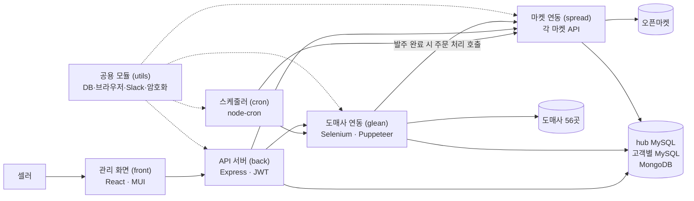
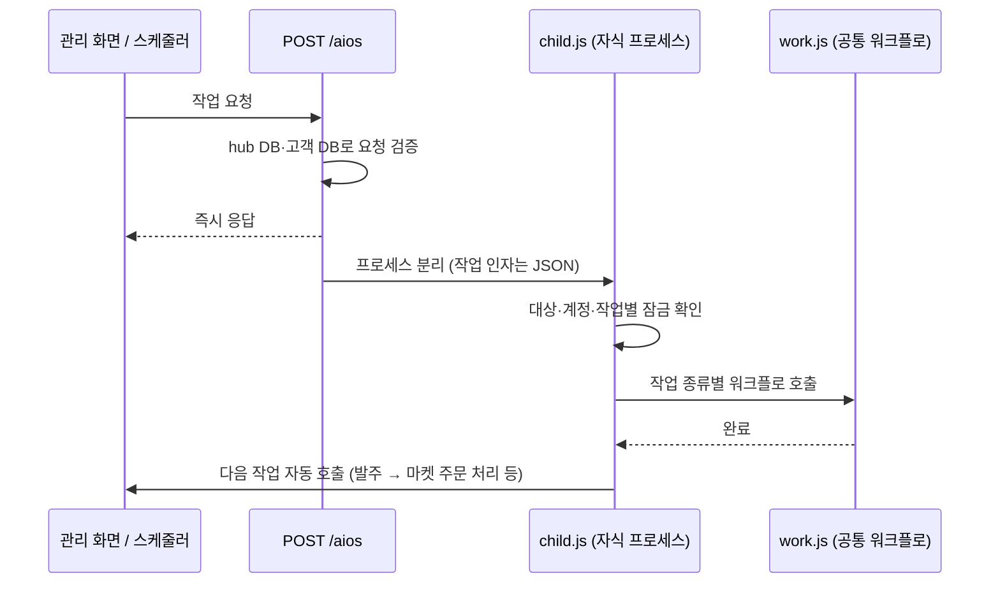

# AIOS · 전자상거래 통합 자동화 서비스

> 도매사 상품을 수집해 오픈마켓에 등록하고, 들어온 주문을 도매사에 자동 발주해 송장까지 돌려주는 셀러용 자동화 서비스

| 항목 | 내용 |
| --- | --- |
| 기간 | 2020.03 ~ 2025.12 (2020년 공동 사업 → 2022년 개인사업 → 2024년 아이오스㈜ 법인) |
| 인원 | 1명 (기획·설계·개발·인프라·운영) |
| 역할 | 대표이사 · 백엔드/서버 개발 |
| 기술 | Node.js, Express, MySQL, MongoDB, Selenium, Puppeteer, React, MUI, node-cron, AWS Lightsail·SSM, PM2, Nginx, Slack |

## 📊 성과

| 지표 | 규모 |
| --- | --- |
| 연동 도매사 | 56곳 (cafe24·고도몰·메이크샵·스마트스토어 등 11개 플랫폼 계열) |
| 연동 마켓 | 스마트스토어, 쿠팡, 11번가, 아이멤버스, KB Pay 등 |
| 무인 처리 주문 | 일 평균 150건, 도매사 발주부터 송장 등록까지 (수작업 기준 하루 7시간 이상, 약 1명분) |
| 고객사 | 10곳 |
| 월 거래액 | 약 1억 원 |
| 등록 상품 | 약 30만 개 |
| 사업 확장 | 폐쇄몰(국민카드몰·삼성카드몰) 입점, 자체 PB 상품 판매 |

수익 구조는 거래액의 10% 대행 수수료에 자체 판매 마진을 더한 형태였습니다.

## 🏗 시스템 구성

서비스 5개와 공용 라이브러리로 구성했습니다. 사용자의 요청은 API 서버가, 정기 작업은 스케줄러가 받아 도매사 연동(glean)과 마켓 연동(spread) 서버에 넘깁니다. 도매사 발주가 끝나면 마켓 쪽 주문 처리가 자동으로 이어집니다.

| 영역 | 내용 | 기술 |
| --- | --- | --- |
| 백엔드 API | 로그인·권한, 고객별 DB 조회, 작업 요청 전달 | Node.js, Express, MySQL |
| 도매사 연동 (glean) | 상품 수집·변환, 재고 확인, 자동 발주, 송장 수집 | Node.js, MongoDB, Selenium, Puppeteer |
| 마켓 연동 (spread) | 상품 등록·품절, 주문 수집·발송, 취소 | Node.js, 각 마켓 API |
| 스케줄러 (cron) | 고객별 예약 작업 저장과 실행 | node-cron |
| 관리 화면 (front) | 상품·주문 관리, 마켓 등록, 모바일 | React, MUI |
| 공용 모듈 (utils) | DB·브라우저·Slack·암호화 공용 함수 | Node.js |
| 인프라 | 서버 구축·배포·모니터링 | AWS Lightsail·SSM, PM2, Nginx |

## ⚙️ 기술 상세

핵심은 **"요청은 가볍게 받고, 무거운 작업은 독립된 프로세스에서 돌린다"** 는 구조와, **사이트별 차이를 모듈 규격 안에 가두는** 설계입니다.

### 작업 실행 구조

glean과 spread는 같은 패턴을 씁니다.

1. `POST /aios`가 요청 값을 hub DB와 고객 DB로 검증하고 곧바로 응답합니다.
2. 실제 작업은 별도 자식 프로세스(`child.js`)로 분리해 실행합니다. 로그인 정보 등 작업 인자는 JSON으로 넘깁니다.
3. 자식 프로세스는 작업 종류에 따라 공통 워크플로(`work.js`)를 호출합니다. glean은 수집·변환·재고·발주·송장을, spread는 등록·품절·주문·취소를 맡습니다.
4. 운영 환경에서는 대상·계정·작업별 잠금 파일로 중복 실행을 막고, 죽은 프로세스의 잠금은 자동으로 풀어 줍니다.
5. 끝난 작업은 다음 작업을 스스로 호출합니다. 발주가 끝나면 마켓 주문 처리를, 등록이 끝나면 같은 계정의 다음 대기 작업을 실행합니다.

→ 한 고객의 긴 수집 작업이 API 응답이나 다른 고객의 작업을 막지 않습니다.

### 도매사 모듈 규격 (glean)

도매사 하나는 모듈 파일 하나입니다. 플랫폼 공통 로직(로그인, 장바구니, 송장 조회)을 가져다 쓰고, 사이트마다 다른 부분만 구현합니다.

| 메서드 | 역할 |
| --- | --- |
| `init(loginInfo)` | 로그인, 쿠키를 요청 헤더에 보관 |
| `getCategory` → `getProduct` | 카테고리별 상품 ID 목록 수집 |
| `getDetail` | 상품 상세를 원본 그대로 MongoDB에 저장 |
| `convert` | 원본을 공통 상품 형식(상품코드, 상태, 옵션)으로 변환 |
| `addCart` → `order` | 장바구니에 담아 자동 발주 (선택) |
| `getTrackingNumber` | 발주번호로 송장번호 조회 (선택) |

수집은 두 단계로 나눕니다. **gather**는 원본을 MongoDB 임시 컬렉션에 쌓고 끝났을 때 교체하며, **convert**는 MySQL 상품 테이블에 반영합니다. 이 과정에서 구글 시트의 금지어 목록으로 등록 제외 상품을 거르고, 도매사에서 사라진 상품은 단종 처리합니다.

### 마켓 모듈 규격 (spread)

마켓 하나도 모듈 파일 하나입니다. 공통 워크플로는 마켓 종류를 모른 채 같은 메서드만 부릅니다.

- **등록**: 템플릿 해석 → 기존 등록 여부 확인 → 신규 등록 또는 수정 → 판매중지·삭제
- **주문**: 주문 수집 → 통합 주문 형식으로 변환 → 발주확인 → 발송처리, 취소
- 마켓별 주문은 모두 **통합 주문 테이블** 하나로 모여, 발주 로직이 마켓을 구분하지 않고 동작합니다.

### 데이터 모델

| 저장소 | 주요 데이터 |
| --- | --- |
| hub MySQL | 사용자, 예약 작업, 도매사 명부 |
| 고객별 MySQL | 상품, 마켓 계정, 통합 주문 |
| 고객별 MySQL | 마켓별 등록 템플릿·등록 작업·등록 상품 |
| MongoDB | 수집 원본, 수집 진행 상황 |

- 고객이 쓰는 마켓은 설정 테이블이 아니라 마켓별 상품 테이블의 존재로 판단합니다.
- 상품코드는 모든 서비스에서 `도매사코드_상품번호` 형식을 씁니다.

### 인증과 권한

- 로그인하면 API 서버가 사용자 ID, 고객 DB 이름, 권한을 담은 **JWT(12시간 유효)** 를 발급합니다. 모든 요청은 토큰에 담긴 자기 DB에만 접근합니다.
- 만료되거나 잘못된 토큰은 401로 응답하고, 프론트의 전역 인터셉터가 받아 로그인 화면으로 보냅니다.
- 화면 접근 권한은 라우트마다 선언해, 마켓 등록과 예약 작업은 관리자만 쓸 수 있습니다.

## 🔥 문제 해결

### 1. 수집부터 송장까지 전 과정 자동화

**문제** 도매사 상품을 오픈마켓에 올리고 주문을 도매사에 다시 넣는 일이 대부분 수작업이었고, 사이트마다 화면과 로그인 방식이 달랐습니다.

**해결** 상품 수집 → 가공 → 마켓 등록 → 주문 수집 → 도매사 발주 → 송장 등록을 하나의 흐름으로 자동화했습니다.
- 도매사 연동 모듈 56개를 플랫폼 기준 11개 계열로 묶고 공통 로직을 분리 → 새 도매사는 같은 플랫폼 모듈을 복사해 번호만 바꾸면 추가
- 마켓 연동은 스마트스토어, 쿠팡, 11번가, 아이멤버스, KB Pay 등을 같은 규격(등록·주문·취소 메서드)으로 통일
- 자동 발주 전 상품을 다시 조회해 옵션과 가격을 확인하고, 예치금 부족·주소 누락 같은 예외는 상태값과 Slack 알림으로 분리 처리

**결과** 일 평균 150건의 주문을 무인 처리, 수작업 기준 하루 7시간 이상(약 1명분) 절감

### 2. 여러 고객의 작업을 안정적으로 돌리는 구조

**문제** 고객과 도매사, 마켓 계정이 늘어나면서 같은 작업이 겹쳐 돌거나, 잦은 로그인으로 도매사가 IP를 차단하는 문제가 생겼습니다.

**해결**
- API 서버는 바로 응답하고 실제 작업은 자식 프로세스로 분리
- 도매사·계정·작업 종류별 잠금 파일로 중복 실행 방지, 끊긴 수집은 1,000건 단위로 이어서 실행
- 로그인 세션을 캐시해 재사용하고, 처리할 주문이 없으면 도매사에 로그인하지 않도록 해 차단 위험 감소
- 마켓 일일 등록 한도를 넘으면 작업을 대기로 돌리고, 스케줄러에 다음 날 01시 재개 작업을 자동 등록
- 고객마다 별도 DB를 두고, 공용 정보는 hub DB에서 관리

**결과** 고객사 10곳, 등록 상품 약 30만 개 규모를 1인으로 안정 운영

---

[← 메인으로](../README.md)
