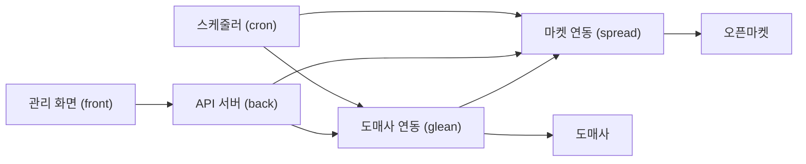

# AIOS 전자상거래 통합 자동화 서비스

## 프로젝트 개요

| 항목 | 내용 |
| --- | --- |
| 기간 | 2020.03 ~ 2025.12 (2020년 공동 사업, 2022년 개인사업, 2024년 아이오스㈜ 법인 전환) |
| 인원 | 1명 |
| 담당 | 기획, 설계, 개발, 인프라, 운영 |
| 기술 | Node.js, Express, MySQL, MongoDB, Selenium, Puppeteer, React, MUI, node-cron, AWS Lightsail·SSM, PM2, Nginx, Slack |

도매사 상품을 수집해 오픈마켓에 등록하고, 들어온 주문을 도매사에 자동으로 발주하여 송장까지 등록하는 전자상거래 통합 자동화 서비스입니다. 셀러는 관리 화면에서 상품과 주문을 한곳에서 확인하고, 반복 작업은 예약 실행으로 처리합니다.

## 운영 규모

| 항목 | 내용 |
| --- | --- |
| 연동 도매사 | 56곳 (11개 플랫폼 계열) |
| 연동 마켓 | 스마트스토어, 쿠팡, 11번가, 아이멤버스, KB Pay 등 |
| 주문 처리 | 일 평균 150건 무인 처리 (수작업 기준 하루 7시간 이상, 약 1명분) |
| 고객사 | 10곳 |
| 월 거래액 | 약 1억 원 |
| 등록 상품 | 약 30만 개 |

거래액의 10%를 대행 수수료로 받는 구조에 자체 판매 마진을 더해 수익을 냈으며, 폐쇄몰(국민카드몰, 삼성카드몰) 입점과 자체 PB 상품 판매로 사업 영역을 넓혔습니다.

## 시스템 구성

서비스 5개와 공용 라이브러리로 구성했습니다. 사용자 요청은 API 서버가, 정기 작업은 스케줄러가 받아 도매사 연동(glean)과 마켓 연동(spread) 서버로 전달합니다. 도매사 발주가 끝나면 마켓 쪽 주문 처리가 이어서 실행됩니다.

| 구분 | 역할 | 기술 |
| --- | --- | --- |
| API 서버 | 로그인·권한, 고객별 DB 조회, 작업 요청 전달 | Node.js, Express, MySQL |
| 도매사 연동 (glean) | 상품 수집·변환, 재고 확인, 자동 발주, 송장 수집 | Node.js, MongoDB, Selenium, Puppeteer |
| 마켓 연동 (spread) | 상품 등록·품절, 주문 수집·발송, 취소 | Node.js, 각 마켓 API |
| 스케줄러 (cron) | 고객별 예약 작업 저장과 실행 | node-cron |
| 관리 화면 (front) | 상품·주문 관리, 마켓 등록, 모바일 | React, MUI |
| 공용 모듈 (utils) | DB, 브라우저, Slack, 암호화 공용 함수 | Node.js |
| 인프라 | 서버 구축, 배포, 모니터링 | AWS Lightsail·SSM, PM2, Nginx |

## 설계 내용

### 작업 실행 구조

요청은 가볍게 받고 무거운 작업은 독립된 프로세스에서 실행하도록 설계했습니다. glean과 spread는 같은 방식으로 동작합니다.

1. `POST /aios`가 요청 값을 hub DB와 고객 DB로 검증한 뒤 바로 응답합니다.
2. 실제 작업은 별도 자식 프로세스(`child.js`)에서 실행하며, 로그인 정보 등 작업 인자는 JSON으로 전달합니다.
3. 자식 프로세스는 작업 종류에 따라 공통 워크플로(`work.js`)를 호출합니다. glean은 수집, 변환, 재고, 발주, 송장을, spread는 등록, 품절, 주문, 취소를 담당합니다.
4. 대상, 계정, 작업별 잠금 파일로 중복 실행을 막고, 종료된 프로세스의 잠금은 자동으로 해제합니다.
5. 작업이 끝나면 다음 작업을 호출합니다. 발주 후에는 마켓 주문 처리를, 등록 후에는 같은 계정의 다음 대기 작업을 실행합니다.

이 구조로 한 고객의 긴 수집 작업이 API 응답이나 다른 고객의 작업에 영향을 주지 않도록 했습니다.

### 도매사 모듈 규격 (glean)

도매사 하나를 모듈 파일 하나로 구성했습니다. 플랫폼 공통 로직(로그인, 장바구니, 송장 조회)은 공유하고, 사이트별로 다른 부분만 구현합니다.

| 메서드 | 역할 |
| --- | --- |
| `init(loginInfo)` | 로그인, 쿠키를 요청 헤더에 보관 |
| `getCategory`, `getProduct` | 카테고리별 상품 ID 목록 수집 |
| `getDetail` | 상품 상세를 원본 그대로 MongoDB에 저장 |
| `convert` | 원본을 공통 상품 형식(상품코드, 상태, 옵션)으로 변환 |
| `addCart`, `order` | 장바구니에 담아 자동 발주 (선택) |
| `getTrackingNumber` | 발주번호로 송장번호 조회 (선택) |

수집은 두 단계로 나눴습니다. gather 단계에서 원본을 MongoDB 임시 컬렉션에 쌓고 완료 시 교체하며, convert 단계에서 MySQL 상품 테이블에 반영합니다. 이 과정에서 구글 시트의 금지어 목록으로 등록 제외 상품을 거르고, 도매사에서 사라진 상품은 단종 처리합니다.

### 마켓 모듈 규격 (spread)

마켓도 하나의 모듈 파일로 구성했으며, 공통 워크플로는 마켓 종류와 관계없이 같은 메서드를 호출합니다.

- 등록: 템플릿 해석, 기존 등록 여부 확인, 신규 등록 또는 수정, 판매중지·삭제
- 주문: 주문 수집, 통합 주문 형식으로 변환, 발주확인, 발송처리, 취소
- 마켓별 주문은 통합 주문 테이블 하나로 모아, 발주 로직이 마켓을 구분하지 않도록 했습니다.

### 데이터 구조

| 저장소 | 주요 데이터 |
| --- | --- |
| hub MySQL | 사용자, 예약 작업, 도매사 명부 |
| 고객별 MySQL | 상품, 마켓 계정, 통합 주문, 마켓별 등록 템플릿·등록 작업·등록 상품 |
| MongoDB | 수집 원본, 수집 진행 상황 |

- 고객이 사용하는 마켓은 별도 설정 테이블이 아니라 마켓별 상품 테이블의 존재 여부로 판단합니다.
- 상품코드는 모든 서비스에서 `도매사코드_상품번호` 형식을 사용합니다.

### 인증과 권한

- 로그인 시 API 서버가 사용자 ID, 고객 DB 이름, 권한을 담은 JWT(유효기간 12시간)를 발급하며, 모든 요청은 토큰에 담긴 해당 고객의 DB에만 접근합니다.
- 만료되거나 잘못된 토큰은 401로 응답하고, 프론트엔드의 전역 인터셉터에서 로그인 화면으로 이동시킵니다.
- 화면 접근 권한은 라우트 단위로 지정하여, 마켓 등록과 예약 작업은 관리자만 사용할 수 있습니다.

## 문제 해결

### 1. 상품 수집부터 송장 등록까지의 자동화

**문제**
도매사 상품을 오픈마켓에 등록하고 주문을 도매사에 다시 넣는 업무가 대부분 수작업이었고, 사이트마다 화면과 로그인 방식이 달랐습니다.

**해결**
- 상품 수집, 가공, 마켓 등록, 주문 수집, 도매사 발주, 송장 등록을 하나의 흐름으로 자동화했습니다. Node.js, Selenium 기반 크롤링과 마켓 API 연동을 함께 사용했습니다.
- 도매사 연동 모듈 56개를 플랫폼 기준 11개 계열(cafe24, 고도몰, 메이크샵, 스마트스토어 등)로 묶고 공통 로직을 분리하여, 신규 도매사는 같은 플랫폼 모듈을 복사해 번호만 바꾸면 추가되도록 했습니다.
- 마켓 연동은 스마트스토어, 쿠팡, 11번가, 아이멤버스, KB Pay 등을 같은 규격(등록, 주문, 취소 메서드)으로 맞췄습니다.
- 자동 발주 전에 상품을 다시 조회해 옵션과 가격을 확인하고, 예치금 부족이나 주소 누락 같은 예외는 상태값과 Slack 알림으로 구분해 처리했습니다.

**결과**
하루 평균 150건의 주문을 무인으로 처리하여, 수작업 기준 하루 7시간 이상(약 1명분)의 업무를 자동화했습니다.

### 2. 다수 고객 작업의 안정적인 실행

**문제**
고객, 도매사, 마켓 계정이 늘어나면서 같은 작업이 중복 실행되거나, 잦은 로그인으로 도매사에서 IP를 차단하는 문제가 발생했습니다.

**해결**
- API 서버는 요청을 받으면 바로 응답하고, 실제 작업은 별도 자식 프로세스에서 실행하도록 분리했습니다.
- 도매사, 계정, 작업 종류별 잠금 파일로 중복 실행을 막고, 중단된 수집은 1,000건 단위로 이어서 실행하도록 했습니다.
- 로그인 세션을 캐시해 재사용하고, 처리할 주문이 없으면 도매사에 로그인하지 않도록 하여 차단 위험을 줄였습니다.
- 마켓의 일일 등록 한도를 넘으면 작업을 대기 상태로 전환하고, 스케줄러에 다음 날 01시 재개 작업을 자동 등록했습니다.
- 고객마다 별도 DB를 두고, 공용 정보는 hub DB에서 관리했습니다.

**결과**
고객사 10곳, 등록 상품 약 30만 개 규모의 서비스를 1인으로 운영했습니다.

[메인으로 돌아가기](../README.md)
