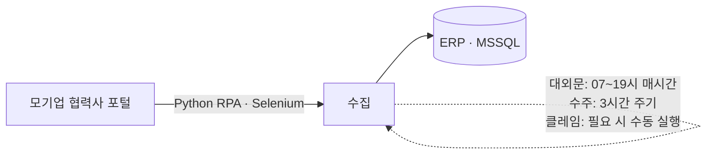

# 제조 현장 디지털 전환 · ㈜금창4공장 ICT팀

> VB 기반 ERP의 한계를 웹으로 보완하고, 반복 입력 업무를 RPA로 자동화

| 항목 | 내용 |
| --- | --- |
| 기간 | 2025.05 ~ 2026.07 |
| 역할 | 선임 매니저 · 백엔드/서버 개발 |
| 기술 | Node.js, Express, Python, React, MSSQL, VB ERP, Selenium, Git, Hiworks |

## 📊 성과

| 항목 | Before | After |
| --- | --- | --- |
| 협력사 포털 데이터 입력 | 5명이 주 2회, 하루 2시간씩 수작업 | Python RPA 자동 수집·ERP 등록 |
| 절감 시간 | - | **연간 약 1,000시간 (약 0.5명분)** |
| 수집 주기 | 주 2회 | **매시간** (대외문 07~19시 매시간, 수주 3시간 주기) |
| 데이터 확인 | ERP·MES·외부 포털에 분산 | 웹 한곳에서 확인 |

## 🛠 주요 작업

### 1. 사내 웹포탈 (React · Node.js)
- VB 기반 ERP의 한계를 보완하기 위해 사내 웹포탈을 구축하고, 현장 업무를 웹·모바일로 옮기는 개발을 주도
- **근태관리**와 **공정순회일지** 웹앱을 데스크탑과 태블릿 모두에서 현장 사용이 가능하도록 화면 최적화

### 2. 현장 데이터 대시보드
- MES 등 현장 데이터를 웹 대시보드로 시각화
- 공장 **라인별 불량률, 태양광 발전량, 온습도**를 한 화면에서 모니터링

### 3. QR 기반 자재 입출고
- 태블릿·휴대폰에서 자재 QR코드를 스캔해, ERP에 등록된 자재의 입출고를 처리·조회

### 4. Python RPA 데이터 자동 수집

- 모기업 협력사 포털의 **대외문·수주·클레임** 데이터를 자동 수집해 ERP에 등록
- 대외문은 07~19시 매시간, 수주는 3시간 주기로 자동 수집하고, 클레임은 필요 시 수동 실행
- 반복 입력 업무의 대부분을 자동화

### 5. 운영
- 운영 서버 관리와 인수인계 문서화 담당

## 💡 돌아보며

전자상거래와는 전혀 다른 현장이었지만, **외부 데이터를 가져와 내 시스템과 잇고 반복 업무를 자동화한다**는 문제의 본질은 같았습니다.

---

[← 메인으로](../README.md)
